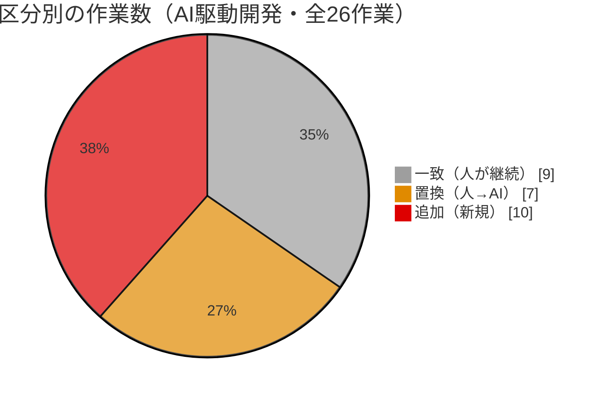
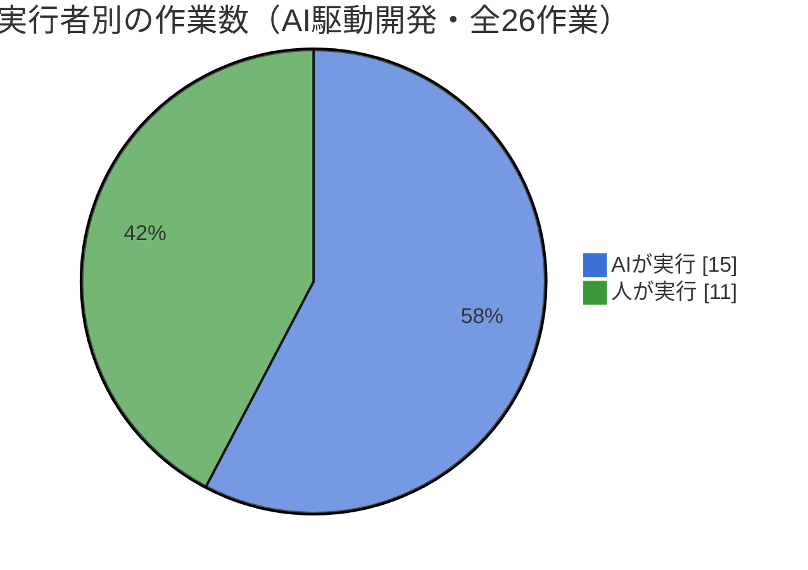
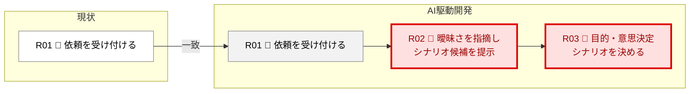
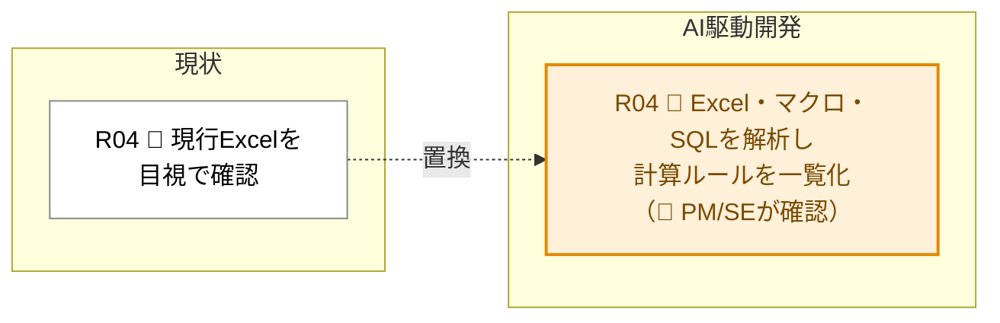
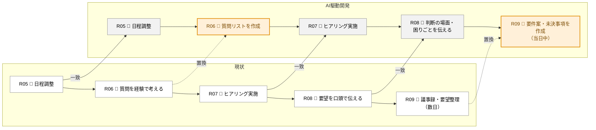
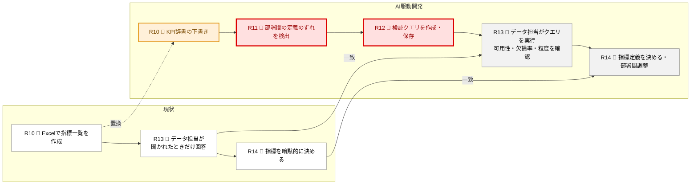
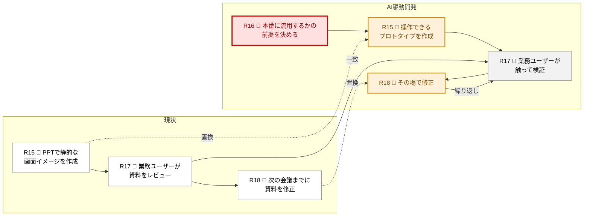
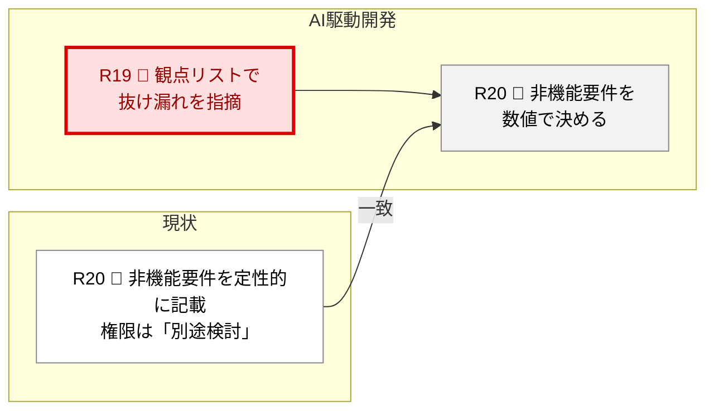
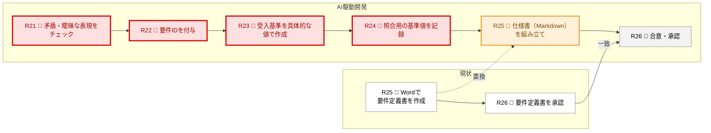
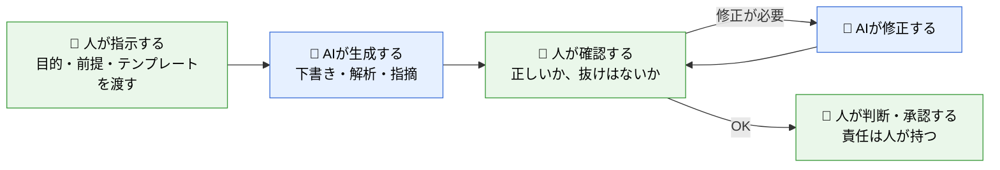

# 要件定義フェーズ比較：現状 と AI駆動開発

| 項目 | 内容 |
|---|---|
| 版 | v0.1（一次案・仮説ベース） |
| 作成日 | 2026-11-24 |
| 対象 | ダッシュボードWebアプリ開発における要件定義フェーズ |
| 関連資料 | [要件定義フロー_ダッシュボード.md](要件定義フロー_ダッシュボード.md)（v0.3） |

> **注意**：「現状」は一般的な開発現場を想定した**仮説**です。実際の業務フローをヒアリングしたうえで更新する前提です。

---

## 1. この資料の目的と凡例

### 1.1 目的

1. 現状の要件定義とAI駆動開発の要件定義を**作業単位で並べて**、「現状と同じ作業」「AIに置き換わる作業」「新しく追加される作業」を区別する
2. AI駆動開発での各作業について、**人がやるのか、AIがやるのか**をはっきりさせる

### 1.2 区分の凡例

| 区分 | 意味 | 図での表記 |
|---|---|---|
| ⚪ **一致** | 現状にも同じ作業があり、AI駆動開発でも**人が担当し続ける**（やり方の変化は「変化点」に記載） | 灰色 |
| 🟠 **置換** | 現状は人がしている作業を、AI駆動開発では**AIが実行する**（人は確認に回る） | オレンジ色 |
| 🔴 **追加** | 現状には**ない作業**。AI駆動開発で新たに加わる | 赤色（太枠） |

### 1.3 担当の凡例

| 表記 | 意味 |
|---|---|
| 🤖 AI | AIが作業を実行する |
| 👤 業務ユーザー | 依頼部門の利用者・責任者 |
| 👤 PM/SE | 要件定義の担当者 |
| 👤 データ担当 | 情報システム部門・DBA |

「実行」は作業を行う主体、「判断・承認」はその結果を確認して決める人です。**AIが実行する作業にも、必ず判断・承認する人を置きます。**

> 文字色が表示されない環境（GitHubなど）でも区別できるよう、⚪🟠🔴 の記号を併記しています。

---

## 2. サマリ

### 2.1 作業数の比較

| | 現状 | AI駆動開発 |
|---|---|---|
| 作業数 | 16 | **26** |
| ⚪ 一致 | — | 9 |
| 🟠 置換 | — | 7 |
| 🔴 追加 | — | 10 |
| 人が実行する作業 | 16（すべて） | **11** |
| AIが実行する作業 | 0 | **15** |

- 作業数は16から26に増えますが、増えた分と置き換わった分の**大半はAIが実行**します。
- 人が実行する作業は16から11に減り、その代わりに**AIの出力を確認・判断する作業**が加わります。

### 2.2 フェーズ別の内訳

| フェーズ | 現状の作業数 | ⚪ 一致 | 🟠 置換 | 🔴 追加 | AI駆動での作業数 |
|---|---|---|---|---|---|
| ① 目的・意思決定シナリオ | 1 | 1 | 0 | 2 | 3 |
| ② 現行調査 | 1 | 0 | 1 | 0 | 1 |
| ③ ヒアリング | 5 | 3 | 2 | 0 | 5 |
| ④ 指標定義・データ検証 | 3 | 2 | 1 | 2 | 5 |
| ⑤ 画面要件・プロトタイプ | 3 | 1 | 2 | 1 | 4 |
| ⑥ 非機能要件 | 1 | 1 | 0 | 1 | 2 |
| ⑦ 受入基準・合意 | 2 | 1 | 1 | 4 | 6 |
| **合計** | **16** | **9** | **7** | **10** | **26** |

**読み取れること**
- **③ヒアリング**は、作業の構成はほぼ現状のままで、準備（質問リスト）と後処理（議事録）がAIに置き換わる。
- **⑦受入基準・合意**は追加が最も多い（4件）。後工程（開発・テスト）とつなぐための作業がここに集中する。
- **①目的**と**④指標定義**の追加は、手戻りの最大要因（G1：指標定義、G3：目的の未定義）に直接効く。

---

## 3. 作業の対応表（現状 ⇔ AI駆動開発）

| ID | 現状の作業 | 現状の担当 | AI駆動開発の作業 | 実行 | 判断・承認 | 区分 | 変化点 |
|---|---|---|---|---|---|---|---|
| **①** | **目的・意思決定シナリオ** | | | | | | |
| R01 | 依頼を受け付ける（「売上が見えるようにしたい」） | 👤 PM/SE | 依頼を受け付ける | 👤 PM/SE | — | ⚪ 一致 | なし |
| R02 | — | — | 依頼の曖昧さを指摘し、意思決定シナリオの候補を提示する | 🤖 AI | 👤 PM/SE | 🔴 追加 | 目的の言語化をAIが促す |
| R03 | —（目的が言葉にされないまま進む） | — | 目的・意思決定シナリオ（誰が・いつ・何を見て・何を判断するか）を決める | 👤 業務ユーザー・PM/SE | 👤 業務ユーザー責任者 | 🔴 追加 | 指標を選ぶ基準ができる |
| **②** | **現行調査** | | | | | | |
| R04 | 現行Excelレポートを目視で確認する | 👤 PM/SE | 現行Excel・マクロ・SQL・DB定義を解析し、計算ルールを一覧にする | 🤖 AI | 👤 PM/SE | 🟠 置換 | 目視から全量解析へ。人は確認に回る |
| **③** | **ヒアリング** | | | | | | |
| R05 | ヒアリングの日程を調整する | 👤 PM/SE | ヒアリングの日程を調整する | 👤 PM/SE | — | ⚪ 一致 | なし |
| R06 | 質問を担当者の経験で考える | 👤 PM/SE | 観点リストを元に質問リストを作る | 🤖 AI | 👤 PM/SE | 🟠 置換 | 担当者による差が小さくなる |
| R07 | ヒアリングを実施する（複数回） | 👤 PM/SE | ヒアリングを実施する（暗黙知・判断の場面を聞き出す） | 👤 PM/SE | — | ⚪ 一致 | 準備済みの論点があるため、聞くことに集中できる |
| R08 | 要望を口頭で伝える（「とりあえず全部見たい」） | 👤 業務ユーザー | 判断の場面・困りごとを伝える | 👤 業務ユーザー | — | ⚪ 一致 | 「何が見たいか」より「何を判断したいか」を伝える |
| R09 | 議事録を作り、要望を整理する（数日） | 👤 PM/SE | 文字起こしから要件案・未決事項・宿題を作る（当日中） | 🤖 AI | 👤 PM/SE | 🟠 置換 | リードタイムが数日から当日に |
| **④** | **指標定義・データ検証** | | | | | | |
| R10 | Excelで指標一覧を作る（計算式・除外条件は曖昧） | 👤 PM/SE | テンプレートに沿ってKPI辞書の下書きを作る | 🤖 AI | 👤 PM/SE | 🟠 置換 | 記載項目が統一され、抜けがなくなる |
| R11 | — | — | 部署間の指標定義のずれを検出する | 🤖 AI | 👤 PM/SE | 🔴 追加 | 例：受注日基準と出荷日基準の混在 |
| R12 | — | — | データ検証用のサンプルクエリを作り、再利用できる形で保存する | 🤖 AI | 👤 データ担当 | 🔴 追加 | 運用中の品質監視にも流用できる |
| R13 | データの有無に回答する（聞かれたときだけ） | 👤 データ担当 | クエリを実行し、データの可用性・欠損率・粒度を確認する | 👤 データ担当 | — | ⚪ 一致 | 必要時のみから、全指標を事前に確認へ |
| R14 | 指標を決める（Excel一覧の承認として暗黙的に） | 👤 業務ユーザー・PM/SE | 指標定義を決め、部署間を調整する | 👤 業務ユーザー・PM/SE | 👤 業務ユーザー責任者 | ⚪ 一致 | AIが検出したずれを元に、明示的に決める |
| **⑤** | **画面要件・プロトタイプ** | | | | | | |
| R15 | PowerPointで静的な画面イメージを作る | 👤 PM/SE | KPI辞書から操作できるプロトタイプを作る | 🤖 AI | 👤 PM/SE | 🟠 置換 | 静的な絵から、動く画面へ |
| R16 | — | — | プロトタイプを本番に流用するかの前提を決める | 👤 PM/SE・開発チーム | 👤 PM/SE | 🔴 追加 | 流用するなら技術スタックを本番に合わせる |
| R17 | 資料をレビューする | 👤 業務ユーザー | プロトタイプを触って検証する | 👤 業務ユーザー | — | ⚪ 一致 | 資料を読む検証から、実物を触る検証へ |
| R18 | 指摘を受けて資料を修正する（次の会議まで） | 👤 PM/SE | 指摘を受けてプロトタイプをその場で修正する | 🤖 AI | 👤 業務ユーザー | 🟠 置換 | 1回の会議で何度も修正・確認を回せる |
| **⑥** | **非機能要件** | | | | | | |
| R19 | — | — | 観点リストを使って非機能・権限の抜け漏れを指摘する | 🤖 AI | 👤 PM/SE | 🔴 追加 | 権限・更新頻度の決め漏れを防ぐ |
| R20 | 非機能要件を決める（「普通に速く」、権限は「別途検討」） | 👤 PM/SE | 非機能要件を数値で決める（例：初期表示3秒以内） | 👤 PM/SE・データ担当 | 👤 PM/SE | ⚪ 一致 | 定性的な記述から数値へ（テストに変換できる） |
| **⑦** | **受入基準・合意** | | | | | | |
| R21 | — | — | 要件の矛盾・曖昧な表現をチェックする | 🤖 AI | 👤 PM/SE | 🔴 追加 | 例：「リアルタイム」と「日次更新」の混在 |
| R22 | — | — | 要件IDを付与する（KPI-001、SCR-003、NFR-010 など） | 🤖 AI | 👤 PM/SE | 🔴 追加 | コード・テストとの紐付けの前提になる |
| R23 | — | — | 受入基準を具体的な値で作る（Given/When/Then） | 🤖 AI | 👤 業務ユーザー | 🔴 追加 | 自動テストに変換できる |
| R24 | — | — | 現行Excelとの照合用の基準値を記録する | 🤖 AI | 👤 業務ユーザー | 🔴 追加 | 数値照合テストの正解データになる |
| R25 | Wordで要件定義書を作る | 👤 PM/SE | 決定事項から仕様書（Markdown）を組み立てる | 🤖 AI | 👤 PM/SE | 🟠 置換 | Gitで管理し、開発時のAIへの入力にする |
| R26 | 要件定義書を承認する | 👤 業務ユーザー責任者 | 仕様に合意し、承認する | 👤 業務ユーザー責任者 | — | ⚪ 一致 | 承認と責任は人が持つ |

---

## 4. フェーズ別の比較図

左が現状、右がAI駆動開発です。実線は「一致（同じ作業を人が続ける）」、点線は「置換（AIに置き換わる）」を表します。線のない右側の赤い作業が「追加」です。

### ① 目的・意思決定シナリオ

### ② 現行調査

### ③ ヒアリング

### ④ 指標定義・データ検証

### ⑤ 画面要件・プロトタイプ

### ⑥ 非機能要件

### ⑦ 受入基準・合意

---

## 5. 人がやる作業とAIがやる作業

### 5.1 基本の考え方

| | 👤 人 | 🤖 AI |
|---|---|---|
| **担うこと** | 意図を決める、判断する、合意を取る、責任を持つ | 生成する、網羅する、矛盾を見つける、形式を変換する |
| **人にしかできない理由 / AIが得意な理由** | 利害関係者との信頼関係、暗黙知の引き出し、組織としての決定権と説明責任が必要 | 大量の資料を短時間で読み、観点の抜けなく、同じ品質で繰り返し作業できる |
| **AIに任せてはいけないこと** | 目的・優先順位の決定、指標定義の最終決定、部署間の調整、承認 | — |

### 5.2 フェーズ別の役割分担（AI駆動開発）

| フェーズ | 👤 人がやる作業 | 🤖 AIがやる作業 |
|---|---|---|
| ① 目的・意思決定シナリオ | R01 依頼を受け付ける R03 目的・意思決定シナリオを決める | R02 曖昧さを指摘し、シナリオ候補を提示する |
| ② 現行調査 | （R04の解析結果を確認する） | R04 Excel・マクロ・SQLを解析し、計算ルールを一覧にする |
| ③ ヒアリング | R05 日程を調整する R07 ヒアリングを実施する R08 判断の場面・困りごとを伝える（業務ユーザー） | R06 質問リストを作る R09 要件案・未決事項・宿題を作る |
| ④ 指標定義・データ検証 | R13 クエリを実行し、データを確認する（データ担当） R14 指標定義を決め、部署間を調整する | R10 KPI辞書の下書きを作る R11 定義のずれを検出する R12 検証クエリを作り、保存する |
| ⑤ 画面要件・プロトタイプ | R16 本番に流用するかの前提を決める R17 プロトタイプを触って検証する（業務ユーザー） | R15 プロトタイプを作る R18 指摘を受けてその場で修正する |
| ⑥ 非機能要件 | R20 非機能要件を数値で決める | R19 抜け漏れを指摘する |
| ⑦ 受入基準・合意 | R26 合意・承認する | R21 矛盾・曖昧さをチェックする R22 要件IDを付与する R23 受入基準を作る R24 照合用の基準値を記録する R25 仕様書を組み立てる |
| **作業数** | **11** | **15** |

### 5.3 役割ごとの作業一覧

| 役割 | 担当する作業（実行） | 判断・承認する作業 |
|---|---|---|
| 👤 業務ユーザー（責任者を含む） | R03、R08、R14、R17 | R03、R14、R18、R23、R24、R26 |
| 👤 PM/SE | R01、R03、R05、R07、R14、R16、R20 | R02、R04、R06、R09、R10、R11、R15、R16、R19、R20、R21、R22、R25 |
| 👤 データ担当 | R13、R20 | R12 |
| 🤖 AI | R02、R04、R06、R09、R10、R11、R12、R15、R18、R19、R21、R22、R23、R24、R25 | なし（判断・承認はすべて人） |

**PM/SEの役割の変化**：判断・承認する作業が13件と最も多くなります。PM/SEは「資料を作る人」から「**AIの出力を確認し、判断する人**」に変わります。

### 5.4 人とAIの協働の基本サイクル

AIが実行するすべての作業は、次のサイクルで進めます。

### 5.5 人の作業の性質の変化

| 作業の性質 | 現状（人の作業） | AI駆動開発（人の作業） | 変化 |
|---|---|---|---|
| **作成・整理**（資料・議事録・一覧を作る） | 7件（R04、R06、R09、R10、R15、R18、R25） | **0件** | すべてAIに移る |
| **対話・検証**（聞く、伝える、触って確かめる） | 6件（R01、R05、R07、R08、R13、R17） | 6件 | 同じ。ただし準備済みの論点や実物で、質が上がる |
| **判断・合意**（決める、調整する、承認する） | 3件（R14、R20、R26） | **5件**（R03、R14、R16、R20、R26） | 増える。目的の定義と流用の判断が加わる |
| **AI出力の確認** | 0件 | **15件** | 新たに発生する |

> **注意**：「AI出力の確認」の15件が新しい負荷になります。確認の観点が決まっていないとPM/SEがボトルネックになるため、作業ごとに「何を確認すればOKとするか」をあらかじめ決めておく必要があります。

---

## 6. 補足

### 6.1 関連資料との区分の違い

関連資料（[要件定義フロー_ダッシュボード.md](要件定義フロー_ダッシュボード.md) の7章）では「追加」としていた次の作業を、本資料では**現状にも対応する作業があるため「一致」**としています。本資料のほうが、作業単位で細かく現状と対応付けています。

| 作業 | 関連資料7章 | 本資料 | 理由 |
|---|---|---|---|
| R13 データ担当によるデータ確認 | 追加 | ⚪ 一致 | 現状にも「聞かれたときに回答する」作業がある。進め方が変わる |
| R17 プロトタイプを触って検証 | 追加 | ⚪ 一致 | 現状にも「資料をレビューする」作業がある。対象が実物に変わる |
| R20 非機能要件を数値で決める | 追加 | ⚪ 一致 | 現状にも非機能要件を決める作業がある。書き方が数値に変わる |

### 6.2 対象外としたもの

- **事前準備**（仕様テンプレート、観点リスト、プロンプト集、AI利用ガイドラインの整備）：案件ごとの作業ではなく初回のみの作業のため、本資料の比較からは除いています。関連資料の7.6を参照してください。
- **開発工程以降の作業**：関連資料の8章を参照してください。
