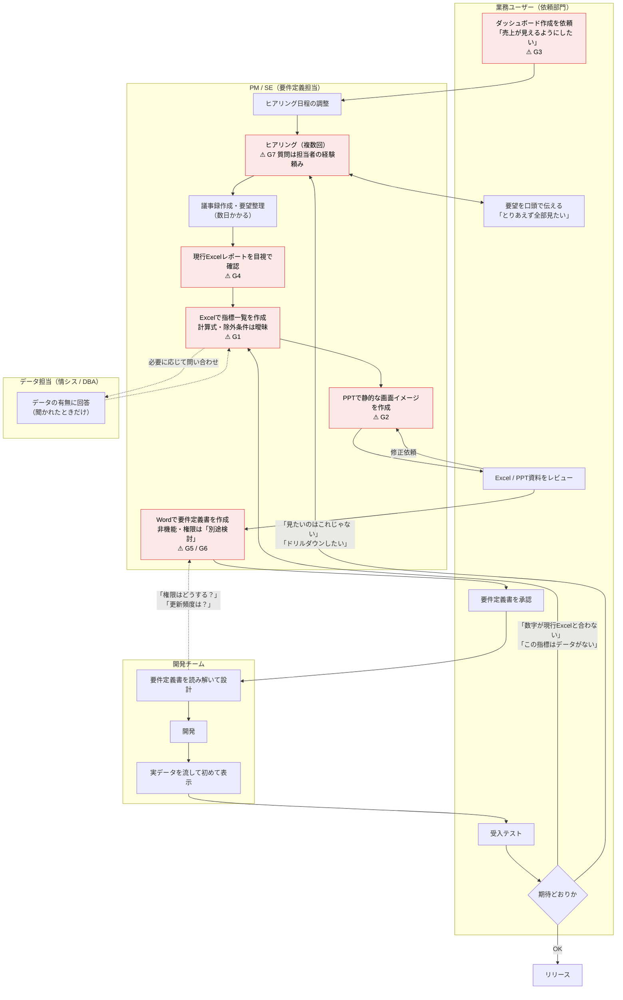
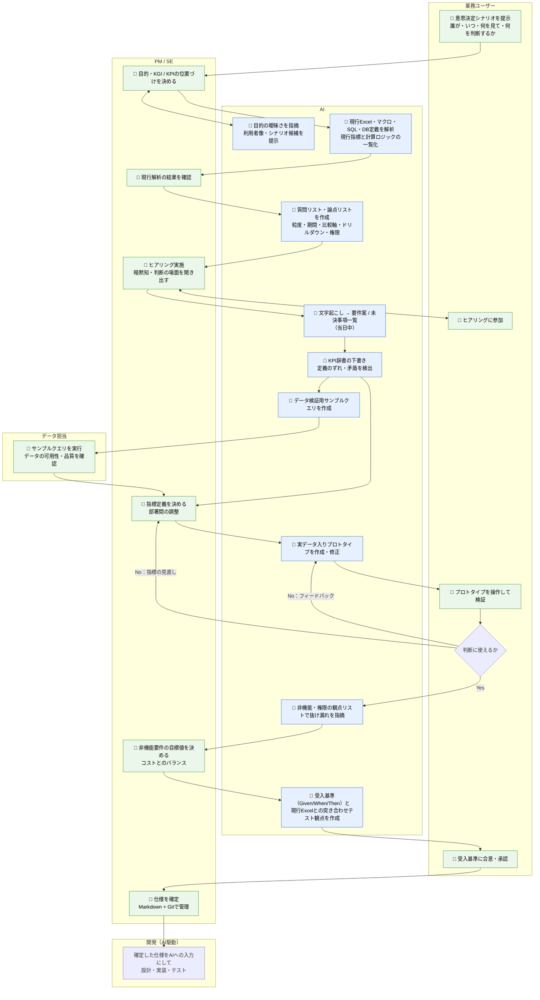
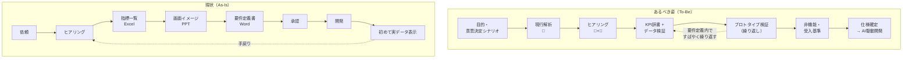
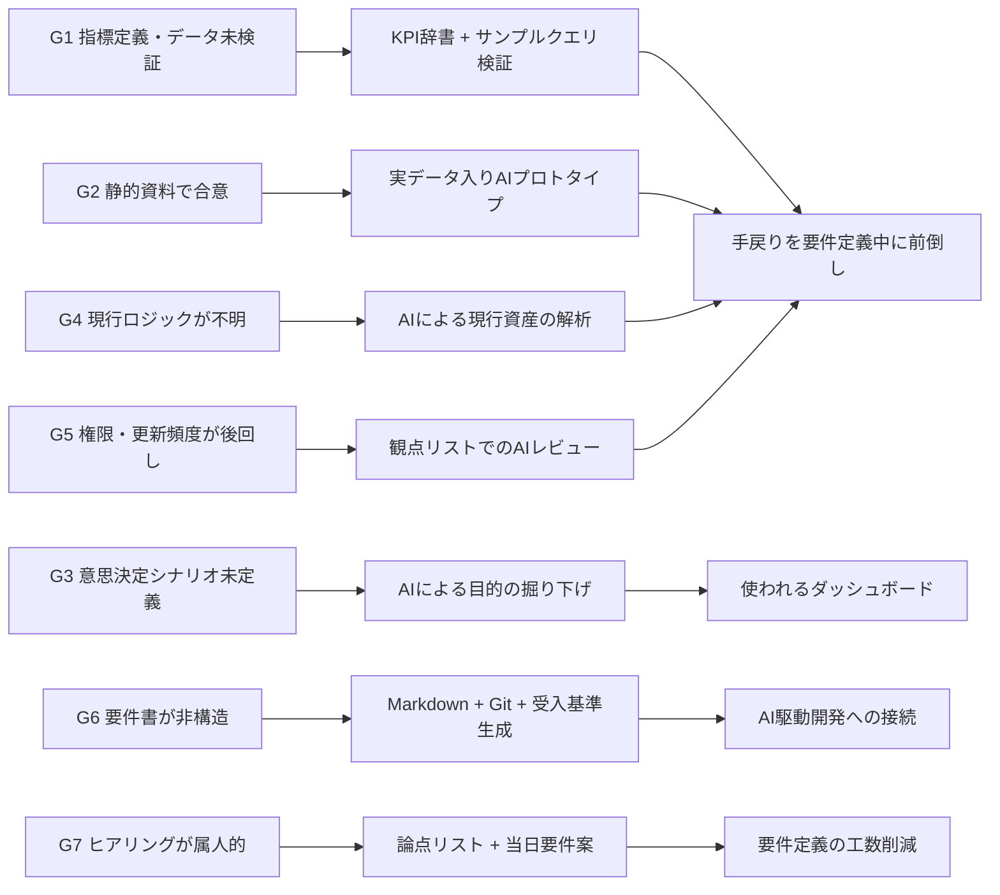
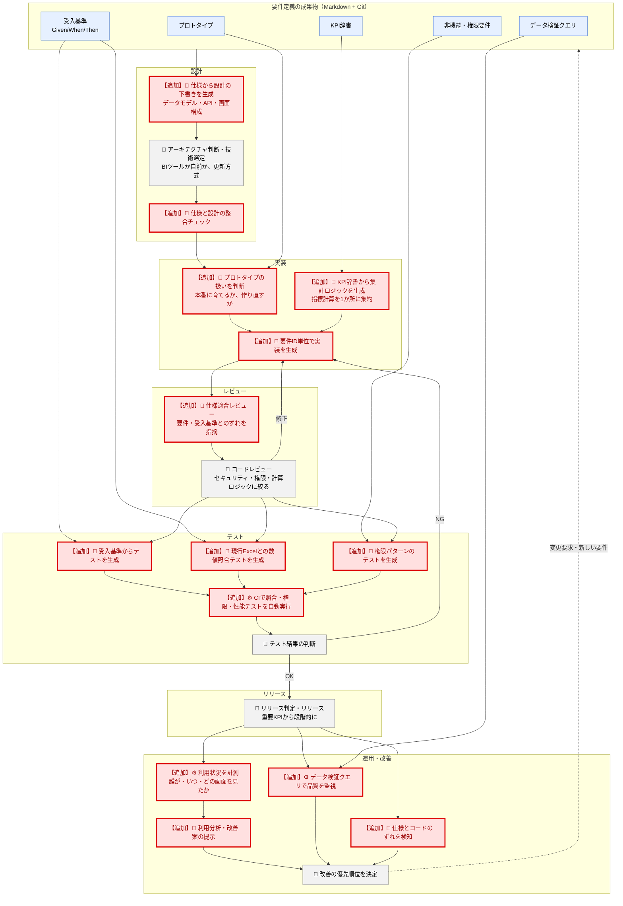

# ダッシュボードWebアプリ 要件定義業務フロー（現状 / あるべき姿 / ギャップ）

| 項目 | 内容 |
|---|---|
| 版 | v0.3（一次案・仮説ベース） |
| 改訂履歴 | v0.1 要件定義フロー（現状 / あるべき姿 / ギャップ） v0.2 「開発プロセスへの展開」を追加 v0.3 セクション7「要件定義フェーズの改善作業」を追加（開発プロセスは8章、次のステップは9章に繰り下げ） |
| 作成日 | 2026-11-23 |
| 対象 | ダッシュボードWebアプリ開発における要件定義フェーズ |
| 位置づけ | AI駆動開発を前提とした要件定義の改善検討のたたき台 |

> **注意**：本資料の「現状（As-Is）」は、一般的な開発現場を想定した**仮説**です。実際の業務フロー・成果物・会議体をヒアリングしたうえで更新する前提です。

---

## 1. 前提

### 1.1 登場人物

| 役割 | 現状（As-Is） | あるべき姿（To-Be） |
|---|---|---|
| 業務ユーザー（依頼部門） | 要望を伝え、資料をレビュー・承認する | 意思決定シナリオを提示し、プロトタイプを触って検証する |
| PM / SE（要件定義担当） | ヒアリング、議事録・資料作成をすべて手作業で行う | 問いを立て、論点を判断し、合意形成を行う |
| データ担当（情シス / DBA） | 問い合わせがあったときだけデータの有無に回答する | AIが生成したクエリでデータの可用性・品質を早期に検証する |
| AI | （使っていない、または個人単位での利用にとどまる） | 解析、下書き、抜け漏れ検出、プロトタイプ作成、受入基準作成 |
| 開発チーム | 要件定義書を読み解いて設計・開発する | 確定した仕様（Markdown）をAIへの入力にして開発する |

### 1.2 ダッシュボード開発ならではの特徴

- **見るまで要求がはっきりしない**：グラフの種類、情報量、ドリルダウンの要望は、実物を見て初めて出てくる
- **指標の定義がずれやすい**：「売上」「アクティブユーザー」の定義が部署ごとに違う
- **データ次第で実現できるかが決まる**：データがない、粒度が足りない、品質が悪いことがある
- **作っても使われないリスクが高い**：誰が、どの判断に使うのかが曖昧なまま作られがち

---

## 2. 現状（As-Is）業務フロー【仮説】

⚠ の付いたステップがギャップの発生箇所です（番号はセクション4のギャップ一覧に対応）。

### 2.1 現状フローの問題点（要約）

- **文書で合意してから作る**流れのため、ずれに気づくのが**開発後（受入テスト時）**になる
- 手戻りは「指標定義・データ」と「画面・操作」の2種類で、どちらも要件定義の最初のほうまで戻る
- PM / SE の時間の多くが、議事録・Excel・PPT・Wordの**作成作業**に使われている

---

## 3. あるべき姿（To-Be）業務フロー

🤖 はAIが主に担うステップ、👤 は人が主に担うステップです。

### 3.1 あるべき姿のポイント

- **作って見せながら合意する**：AIでプロトタイプを安く速く作れるので、検証の繰り返しを要件定義の**中**で回す
- **指標とデータを先に固める**：KPI辞書とデータ検証を、画面の検討より**前**に置く
- **人は「問う・決める・合意する」に集中する**：作成作業はAIが担い、人の工数は判断と調整に回す
- **仕様がそのまま後工程の入力になる**：Markdown + Git の仕様書を、AI駆動開発の入力として使う

---

## 4. フェーズ別の比較とギャップ

### 4.1 全体の比較（フェーズ単位）

### 4.2 フェーズ別の詳細

| # | フェーズ | 現状（仮説） | あるべき姿 | ギャップ |
|---|---|---|---|---|
| ① | 目的・意思決定シナリオ | 「売上が見たい」「全部見たい」から始まる | 「誰が・いつ・何を見て・何を判断するか」を定義する。AIが曖昧さを指摘する | 指標を選ぶ基準がなく、要望が膨らむ。作っても使われない |
| ② | 現行調査 | 現行Excelを目視で確認。計算式・参照先は見落とされる | AIがExcel・マクロ・SQLを解析し、現行ロジックを一覧化する | 現行ロジックが暗黙の仕様のまま残り、数字が合わない |
| ③ | ヒアリング | 質問の質は担当者の経験頼み。議事録に数日かかる | AIが論点リストを準備し、当日中に要件案と未決事項を出す | 聞き漏れがあり、まとめるまでのリードタイムも長い |
| ④ | 指標定義・データ検証 | Excelの指標一覧。データが揃うかは開発時に判明 | 構造化したKPI辞書とサンプルクエリでの事前検証 | 定義の曖昧さとデータ未検証。**手戻りの最大要因** |
| ⑤ | 画面・プロトタイプ | PPTの静的イメージで合意 | 実データ入りのプロトタイプを触って検証を繰り返す | 実物を見ずに合意しているため、後から要望が出る |
| ⑥ | 非機能要件 | 「普通に速く」「権限は後で」 | AIの観点リストで抜け漏れを指摘し、人が目標値を決める | 権限・更新頻度が後から決まり、設計をやり直す |
| ⑦ | 受入基準・合意 | Wordに押印。テストとは別管理 | Given/When/Then形式の受入基準。Markdown + Gitで管理 | 「正しい数字」の基準がなく、後工程とつながらない |

---

## 5. ギャップ一覧（優先度順）

| ID | ギャップ | 影響 | AIによる解消策 | 優先度 |
|---|---|---|---|---|
| G1 | 指標定義が曖昧で、データで実現できるか未検証 | 開発後に「数字が合わない」「出せない」が発覚 | KPI辞書の下書き、定義のずれ検出、サンプルクエリでの検証 | **高** |
| G2 | 静的な資料で合意している | 画面・操作に関する手戻り | 実データ入りプロトタイプの即時作成 | **高** |
| G3 | 意思決定シナリオが未定義 | 要望が膨らむ、使われない | 目的を掘り下げる問いかけ、シナリオ候補の提示 | **高** |
| G4 | 現行の計算ロジックがブラックボックス | 現行Excelとの数字の不一致 | Excel・SQL・マクロの解析、現行仕様の逆算 | 中 |
| G5 | 権限・データ更新頻度が後から決まる | 設計のやり直し | 観点リストによるAIレビュー | 中 |
| G6 | 要件書が構造化されておらず、後工程とつながらない | 変更影響が追えない、AIに渡せない | Markdown化・Git管理、受入基準の自動作成 | 中 |
| G7 | ヒアリングの質が属人的で、整理に時間がかかる | 聞き漏れ、リードタイムの長さ | 論点リストの作成、文字起こしからの要件案作成 | 中（すぐ始めやすい） |

### 5.1 ギャップと解消策の対応

---

## 6. 人とAIの役割分担（To-Be）

| フェーズ | 人（👤） | AI（🤖） | 承認者 |
|---|---|---|---|
| ① 目的・シナリオ | 目的・成功基準を決める | 曖昧さの指摘、シナリオ候補の提示 | 業務ユーザー責任者 |
| ② 現行調査 | 解析結果の確認 | 現行資産の解析・一覧化 | PM / SE |
| ③ ヒアリング | 実施、暗黙知の引き出し | 論点リスト、議事録、要件案 | PM / SE |
| ④ 指標定義・データ検証 | 定義の決定、部署間調整、クエリ実行 | KPI辞書の下書き、ずれ検出、クエリ作成 | 業務ユーザー責任者 |
| ⑤ プロトタイプ | 操作して検証、フィードバック | プロトタイプの作成・修正 | 業務ユーザー |
| ⑥ 非機能要件 | 目標値の決定 | 観点リストでの抜け漏れ指摘 | PM / SE・情シス |
| ⑦ 受入基準・合意 | 合意・承認 | 受入基準・テスト観点の作成 | 業務ユーザー責任者 |

> **原則**：AIが作ったものでも、承認と責任は人が持つ。

---

## 7. 要件定義フェーズの改善作業

> **凡例**
> - 🔴 **赤色 = 追加**：今はしていないが、AIで新たにできるようになる作業（区分B・C）
> - 🟠 **オレンジ色 = 置き換え**：今は人が手作業でしている作業を、AIに任せて効率化する（区分A）
> - 🟣 **紫色 = 事前準備**：最初に一度整えれば、その後の案件で繰り返し使える（区分D）
> - 無印・灰色 = 従来から人が担う作業
>
> （文字色が表示されない環境でも区別できるよう、表では 🔴🟠🟣、図では【追加】【置換】【準備】の表記を併記しています）

### 7.1 整理の観点

| 区分 | 意味 | 効果の性質 |
|---|---|---|
| 🟠 **A. 置き換え** | 今は人が手作業でしている作業を、AIに任せて効率化する | 工数削減・リードタイム短縮 |
| 🔴 **B. 追加** | 今はしていないが、AIを使うことで新たにできるようになる作業 | 手戻り削減・品質向上（**効果大**） |
| 🔴 **C. 後工程とつなぐための追加** | セクション8の開発改善を成り立たせるために、要件定義で新たに必要になる作業 | 開発工程の自動化の前提になる（**効果大**） |
| 🟣 **D. 事前準備** | 最初に一度だけ整えれば、その後の案件で繰り返し使える準備作業 | 改善を組織に定着させる |

### 7.2 要件定義フローにおける改善作業の位置づけ

👤 = 人、🤖 = AI

```mermaid
flowchart TD
    subgraph PREP["事前準備（初回のみ・以降は再利用）"]
        direction LR
        X1["【準備】仕様テンプレート<br/>KPI辞書・画面・非機能・受入基準"]
        X2["【準備】観点リスト<br/>ヒアリング・非機能・権限"]
        X3["【準備】プロンプト集"]
        X4["【準備】AI利用ガイドライン"]
    end

    subgraph F1["① 目的・意思決定シナリオ"]
        S11["【追加】🤖 依頼の曖昧さを指摘<br/>意思決定シナリオの候補を提示"]
        S12["👤 目的・意思決定シナリオを決める"]
    end

    subgraph F2["② 現行調査"]
        S21["【追加】🤖 現行Excel・マクロ・SQLを解析<br/>隠れた計算ルールを一覧化"]
        S22["👤 解析結果を確認"]
    end

    subgraph F3["③ ヒアリング"]
        S31["【置換】🤖 質問リストを作成"]
        S32["👤 ヒアリングを実施"]
        S33["【置換】🤖 文字起こし → 要件案・未決事項<br/>（当日中）"]
    end

    subgraph F4["④ 指標定義・データ検証"]
        S41["【置換】🤖 KPI辞書の下書き"]
        S42["【追加】🤖 部署間の定義のずれを検出"]
        S43["【追加】🤖 データ検証用サンプルクエリを作成<br/>再利用できる形で保存"]
        S44["【追加】👤 データ担当がクエリを実行<br/>可用性・欠損率・粒度を確認"]
        S45["👤 指標定義を決める・部署間調整"]
    end

    subgraph F5["⑤ 画面要件・プロトタイプ"]
        S51["【追加】👤 プロトタイプを本番に流用するかの前提を決める"]
        S52["【置換】🤖 操作できるプロトタイプを作成"]
        S53["【追加】👤 利用者が触って検証<br/>→ 🤖 その場で修正（繰り返し）"]
    end

    subgraph F6["⑥ 非機能要件"]
        S61["【追加】🤖 観点リストで抜け漏れを指摘"]
        S62["【追加】👤 非機能要件を数値で決める<br/>例：初期表示3秒以内"]
    end

    subgraph F7["⑦ 受入基準・合意"]
        S71["【追加】🤖 要件の矛盾・曖昧な表現をチェック"]
        S72["【追加】👤🤖 要件IDを付与<br/>KPI-001 / SCR-003 / NFR-010"]
        S73["【追加】🤖 受入基準を具体的な値で作成"]
        S74["【追加】🤖 現行Excelとの照合用基準値を記録"]
        S75["【置換】🤖 仕様書（Markdown）を組み立て"]
        S76["👤 合意・承認"]
    end

    PREP -. "全フェーズで利用" .-> F1
    S11 --> S12 --> S21 --> S22 --> S31 --> S32 --> S33
    S33 --> S41 --> S42 --> S43 --> S44 --> S45
    S45 --> S51 --> S52 --> S53
    S53 -->|"指標の見直し"| S45
    S53 --> S61 --> S62
    S62 --> S71 --> S72 --> S73 --> S74 --> S75 --> S76
    S76 ==> DEV["セクション8 開発プロセスへ"]

    classDef newTask fill:#ffe0e0,stroke:#d00,stroke-width:3px,color:#900
    classDef replTask fill:#fff0d9,stroke:#e08a00,stroke-width:2px,color:#7a4a00
    classDef prepTask fill:#efe6ff,stroke:#7a4fd0,stroke-width:2px,color:#3d1f80
    classDef baseTask fill:#f2f2f2,stroke:#888,color:#000
    class S11,S21,S42,S43,S44,S51,S53,S61,S62,S71,S72,S73,S74 newTask
    class S31,S33,S41,S52,S75 replTask
    class X1,X2,X3,X4 prepTask
    class S12,S22,S32,S45,S76,DEV baseTask
```

### 7.3 区分A：置き換え（効率化）

| フェーズ | 今の作業 | 改善後の作業 | 具体例 | 見込める改善 |
|---|---|---|---|---|
| ③ ヒアリング | 人が議事録を作り、数日かけて整理する | 🟠 文字起こしから要約、要件案、未決事項の一覧までを当日中に作る | 会議の録音から「決まったこと / 未決事項 / 宿題（担当と期限）/ 要件候補」の4つに分けて出力する | 整理の工数とリードタイムが大きく減る |
| ③ ヒアリング | 質問は担当者の経験で考える | 🟠 業務と目的を入力すると、質問リストをAIが作る | 判断の場面、比較軸（前年比・目標比）、粒度（日・週・月）、ドリルダウンの深さ、データの更新頻度などを質問項目にする | 聞き漏れが減り、担当者による差が小さくなる |
| ④ 指標定義 | Excelの指標一覧を人が手作業で作る | 🟠 議事録と現行資料からKPI辞書の下書きを作る | 指標名・計算式・粒度・期間・データソース・除外条件・責任者の各項目を埋めた状態で出す | 作成工数が減り、記載の抜けもなくなる |
| ⑤ 画面要件 | PowerPointで静的な画面イメージを作る | 🟠 KPI辞書から、操作できるプロトタイプを作る | フィルタやドリルダウンが実際に動くHTML画面を数時間で作る | 画面作成の工数が減り、合意の精度が上がる |
| ⑦ 要件定義書 | Wordで清書する | 🟠 決定事項から、決まった形式の仕様書（Markdown）を自動で組み立てる | KPI辞書・画面・非機能・受入基準を1つの仕様にまとめる | 清書の工数が減る |

### 7.4 区分B：追加（新たにできる作業）

| フェーズ | 追加する作業 | 具体例 | 解消するギャップ |
|---|---|---|---|
| ① 目的定義 | 🔴 依頼の曖昧さを指摘し、意思決定シナリオの候補を出す | 「売上が見たい」という依頼に対し、「誰が見るか（部長か担当者か）」「何を判断するか（目標未達への対策か、予算配分か）」を問い返し、シナリオ案を3つ示す | G3 |
| ② 現行調査 | 🔴 現行のExcel・マクロ・SQLを解析し、計算ロジックを一覧にする | 「売上合計 = 出荷日基準、返品を除く、税抜」のように、隠れた計算ルールを書き出す | G4 |
| ④ 指標定義 | 🔴 部署間の定義のずれを検出する | 営業部の「売上」は受注日基準、経理部の「売上」は出荷日基準、といったずれを指摘する | G1 |
| ④ データ検証 | 🔴 データ検証用のサンプルクエリを作り、データ担当が実行する | 指標ごとに「データがあるか・欠損率・取得できる期間・粒度」を確認するSQLを作る | G1 |
| ⑤ 画面検証 | 🔴 利用者がプロトタイプを触って検証し、AIがその場で修正する。これを繰り返す | 1回のレビュー会で「触る → 指摘 → AIが修正 → 再確認」を回す | G2 |
| ⑥ 非機能要件 | 🔴 観点リストを使って抜け漏れを指摘する | 行単位の権限、データ更新頻度、表示速度、CSV出力、監査ログ、スマホ対応の未決項目を指摘する | G5 |
| 全体（⑦で実施） | 🔴 要件の矛盾・曖昧な表現をチェックする | 「リアルタイム」と「日次更新」の混在、「適宜」「など」の使用箇所を指摘する | G6 |

### 7.5 区分C：後工程とつなぐための追加作業

セクション8の開発改善は、**要件定義で次の作業をしていることが前提**になる。見落とされやすいため特に重要。

| 追加する作業 | 担当 | 理由（つながる後工程） |
|---|---|---|
| 🔴 要件ごとにIDを振る（例：`KPI-001`、`SCR-003`、`NFR-010`） | 👤🤖 | コード・テストとの紐付け、変更の影響分析（8.3、8.4） |
| 🔴 KPI辞書の項目と書き方を統一する（テンプレートに従う） | 👤 | 集計ロジックを自動生成するため（8.8の①） |
| 🔴 受入基準を、テストに変換できる具体的な値で書く | 🤖 | 「正しく表示される」ではなく「2026年10月・東日本・税抜のとき、売上 = 12,345,000円」のように書く（8.8の②） |
| 🔴 現行Excelとの照合用の基準値を記録しておく | 🤖 | 数値照合テストの正解データになる |
| 🔴 非機能要件を数値で決める | 👤 | 「速く」ではなく「初期表示3秒以内」と書けば、性能テストのシナリオに変換できる |
| 🔴 プロトタイプを本番に流用するかの前提を決める | 👤 | 流用するなら、技術スタックを本番に合わせて作る必要がある |
| 🔴 データ検証クエリを再利用できる形で保存する | 🤖 | 運用中の品質監視に流用するため |

### 7.6 区分D：事前準備（一度整えれば繰り返し使える）

| 準備する作業 | 内容 |
|---|---|
| 🟣 仕様テンプレートの作成 | KPI辞書、画面要件、非機能要件、受入基準のMarkdownテンプレート |
| 🟣 観点リストの作成 | ダッシュボード向けのヒアリング観点と、非機能・権限の観点 |
| 🟣 プロンプト集の作成 | 議事録整理、KPI辞書作成、定義のずれ検出、プロトタイプ作成など、作業ごとのAIへの指示文 |
| 🟣 AI利用ガイドラインの作成 | AIに入力してよい情報の範囲、人が確認するポイント、承認ルール |

### 7.7 すぐに試せる3つ（推奨）

1. 🟠 **議事録から要件案・未決事項を作る（区分A）**：ツールさえあればすぐ始められ、工数削減を数字で示しやすい
2. 🔴 **部署間の定義のずれ検出と、KPI辞書の下書き（区分B）**：「数字が合わない」という手戻りの最大の原因（G1）に直接効く
3. 🔴 **受入基準を具体的な値で書く（区分C）**：要件定義の書き方を変えるだけでよく、開発工程の改善（数値照合テスト）につながる

> **ポイント**：要件定義フェーズの改善は、「AIで速くする（区分A）」だけでは工数削減にとどまる。効果が大きいのは、**今は誰もしていない作業をAIで追加すること（区分B）**と、**後工程で使える形で書くこと（区分C）**。

---

## 8. 開発プロセスへの展開（改善案）

> **凡例**：🔴 **赤色 = 今回の改善で追加になる作業** ／ 無印・灰色 = 従来から存在する作業
> （Markdownの文字色が表示されない環境でも区別できるよう、表では 🔴、図では「【追加】」の表記を併記しています）

### 8.1 考え方

あるべき姿の要件定義では、**構造化された成果物**（KPI辞書、データ検証クエリ、プロトタイプ、受入基準、非機能要件）が Markdown + Git で管理されます。
これらを**AIへの入力として後工程に流す**ことで、開発プロセスを「要件定義書を人が読み解いて作り直す」形から、「**仕様を起点にAIが生成し、人が判断・検証する**」形（spec駆動開発）に変えます。

### 8.2 要件定義〜開発〜運用の全体フロー

👤 = 人、🤖 = AI、⚙ = CI（自動実行）

### 8.3 要件定義の成果物の活用先

| 要件定義の成果物 | 開発工程での活用（すべて今回の追加作業） | 見込める改善 |
|---|---|---|
| KPI辞書 | 🔴 AIで集計SQL・データマート・計算ロジックを生成し、指標計算を1か所に集約する | 画面ごとの数字のずれがなくなる。集計ロジックの実装工数が減る |
| データ検証クエリ | 🔴 データ取り込みの品質チェック、運用中のデータ監視に流用する | データ品質の問題に早く気づける |
| プロトタイプ | 🔴 合意済みの画面構成・グラフ定義を本番実装の設計入力にする | 画面設計の工数と、UIの手戻りが減る |
| 受入基準 | 🔴 AIで自動テスト（指標計算の単体テスト、E2Eテスト）を生成する | テスト作成工数が減る。「正しい数字」がテストで保証される |
| 現行Excelとの突き合わせ観点 | 🔴 新旧の数値を自動照合する回帰テストにする | 「数字が合わない」を出荷前に検出できる |
| 非機能・権限要件 | 🔴 性能テストのシナリオ、権限パターンのテストを生成する | 権限漏れ・性能劣化を作り込みにくくなる |
| Markdown + Git の仕様 | 🔴 要件ID・コード・テストをAIで紐付ける | 変更の影響範囲がすぐわかる |

### 8.4 工程別の作業一覧（従来 / 追加）

| 工程 | 作業 | 担当 | 区分 |
|---|---|---|---|
| 設計 | アーキテクチャ判断・技術選定 | 👤 人 | 従来 |
| 設計 | 仕様から設計の下書き（データモデル・API・画面構成）を生成 | 🤖 AI | 🔴 **追加** |
| 設計 | 仕様と設計の整合チェック | 🤖 AI | 🔴 **追加** |
| 実装 | プロトタイプを本番に育てるか、作り直すかの判断 | 👤 人 | 🔴 **追加** |
| 実装 | KPI辞書から集計ロジックを生成（指標計算の一元化） | 🤖 AI | 🔴 **追加** |
| 実装 | 要件ID単位での実装生成（従来は人が実装） | 🤖 AI | 🔴 **追加** |
| レビュー | コードレビュー（セキュリティ・権限・計算ロジックに重点化） | 👤 人 | 従来 |
| レビュー | 仕様適合レビュー（要件・受入基準とのずれの指摘） | 🤖 AI | 🔴 **追加** |
| テスト | テスト方針の決定・結果の判断 | 👤 人 | 従来 |
| テスト | 受入基準からのテスト生成 | 🤖 AI | 🔴 **追加** |
| テスト | 現行Excelとの数値照合テストの生成 | 🤖 AI | 🔴 **追加** |
| テスト | 権限パターンのテスト生成 | 🤖 AI | 🔴 **追加** |
| テスト | CIでの照合・権限・性能テストの自動実行 | ⚙ CI | 🔴 **追加** |
| リリース | リリース判定・リリース（重要KPIから段階的に） | 👤 人 | 従来 |
| 運用 | 改善の優先順位の決定 | 👤 人 | 従来 |
| 運用 | データ検証クエリによる品質監視 | ⚙ CI | 🔴 **追加** |
| 運用 | 利用状況の計測（誰が・いつ・どの画面を見たか） | ⚙ CI | 🔴 **追加** |
| 運用 | 利用分析・改善案の提示 | 🤖 AI | 🔴 **追加** |
| 運用 | 仕様とコードのずれの検知 | 🤖 AI | 🔴 **追加** |

### 8.5 開発フェーズでの人とAIの役割

| 領域 | 人（👤） | AI（🤖） |
|---|---|---|
| 設計 | アーキテクチャの判断、技術選定 | 🔴 設計の下書き、仕様との整合チェック |
| 実装 | 重要なロジックの確認、品質の責任、🔴 プロトタイプの扱いの判断 | 🔴 仕様に基づくコード生成 |
| レビュー | セキュリティ・権限・設計判断の確認 | 🔴 仕様への適合チェック、一般的な指摘 |
| テスト | テスト方針の決定、結果の判断 | 🔴 テストコードと照合テストの生成 |
| 運用 | 改善の優先順位を決める | 🔴 利用状況の分析、改善案の提示 |

> 開発者の役割も、要件定義と同じく「**書く人**」から「**判断し、検証し、責任を持つ人**」に変わる。

### 8.6 期待効果と測定指標（案）

具体的な数値は案件・体制によって大きく変わるため、PoCで測定する。

| 期待効果 | 測定指標 |
|---|---|
| 手戻りの減少 | 受入テストでの指摘件数、要件起因の不具合件数 |
| 開発期間の短縮 | 要件確定から初回リリースまでの日数 |
| 数値の信頼性向上 | 現行Excelとの数値不一致の件数 |
| 品質向上 | 権限・性能に関する不具合件数 |
| 活用度の向上 | ダッシュボードの利用者数・利用頻度 |

### 8.7 前提条件と注意点

- **仕様の品質がボトルネックになる**：AIは仕様どおりに作るため、曖昧な仕様は曖昧な実装になる。要件定義の改善と開発の改善はセットで進める
- **レビューの負荷が増える**：AIが大量にコードを生成するため、人が確認する範囲を明確にしないとレビューが追いつかない
- **プロトタイプをそのまま本番にしない**：見た目が動くことと、本番に出せる品質は別物
- **セキュリティ**：データ接続情報や本番データをAIに渡す範囲を決めておく

### 8.8 最初に試す対象（推奨）

1. 🔴 **KPI辞書 → 集計ロジック生成**
2. 🔴 **受入基準 → 現行Excelとの数値照合テスト生成**

どちらも要件定義の改善で作った成果物をそのまま使えるため、要件定義から開発までを通した効果を示しやすい。

---

## 9. 次のステップ（案）

1. **現状フローの検証**：実際の要件定義の流れ・成果物・会議体をヒアリングし、セクション2の仮説を実態に置き換える
2. **ギャップの定量化**：過去案件の手戻り件数と原因（指標定義、画面、非機能など）を集計し、G1〜G7の優先度を確定する
3. 🟣 **事前準備**：7.6の仕様テンプレート・観点リスト・プロンプト集を、PoCで使う最小限の範囲で整備する
4. **PoCの対象選定と試行**：G1（KPI辞書 + データ検証）と G2（AIプロトタイプ）の組み合わせで、小さな案件を1件試行する（🔴 7.7の3つを含める）
5. 🔴 **開発プロセスのPoC**：上記の案件で、8.8の2項目（集計ロジック生成、数値照合テスト生成）まで通しで試行し、8.6の指標を測定する
6. **ガイドライン整備**：AIに入力してよい情報の範囲、人が確認すべきポイント、承認ルールを決める（🔴 開発工程でのAI生成コードのレビュー基準を含む）
